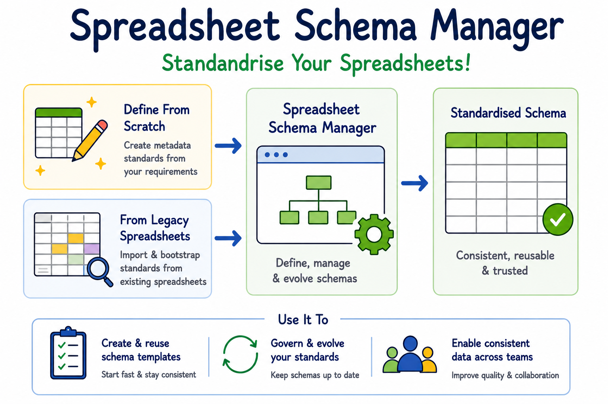

# Spreadsheet Schema Manager

Spreadsheet Schema Manager is a web-based tool for standardising spreadsheet metadata and
improving data consistency across projects and teams. Built with [Rio](https://rio.dev/), it
helps streamline spreadsheet-based data collection workflows by centrally defining Fields,
auto-generating ready-to-fill Excel templates, and bootstrapping metadata standards from legacy
spreadsheets while standardising them at the same time.



## Features

- **Centrally define Fields** — reusable field (data column) definitions (Category, Measurement,
  Text, Number, Date) for consistency across projects and teams, with import/export to/from
  Excel.
- **Auto-generate Excel templates** — group Fields into a reusable **Template**, then instantiate
  a **Workbook** with pre-filled headers and data validation, ready for data collection (with an
  optional QR-code reference sheet).
- **Bootstrap and standardise legacy spreadsheets** — upload existing spreadsheet data as a
  **Dataset** and standardise it against a Field schema, bringing legacy data in line with your
  metadata standards.

## Scope & Beta Feedback

Spreadsheet Schema Manager is currently in beta. The current version focuses on spreadsheets
that contain a single fixed-column table with simple headers. Support for variable column
structures or complex 2D matrix-style tables is not available at this stage.

## Tech stack

- [Rio](https://rio.dev/) — Python web app framework (UI and backend logic both live in Python)
- MongoDB — persistence
- SeaweedFS (S3-compatible object storage) — file storage
- Keycloak — SSO authentication (OpenID Connect)

## Getting started

### Prerequisites

- Python 3.12+
- A running MongoDB instance
- A running SeaweedFS S3-compatible object store

### Install

```bash
pip install -r requirements.txt
```

### Run locally

```bash
python -m rio run
```

Rio serves the app at `http://localhost:8000` by default (see `rio.toml`). For local development
without a Keycloak instance, set `AUTH_DISABLED=true` (see below) to bypass SSO entirely.

### Configuration

The app is configured entirely via environment variables:

| Variable | Purpose |
| --- | --- |
| `MONGO_INITDB_ROOT_USERNAME` / `MONGO_INITDB_ROOT_PASSWORD` | MongoDB credentials |
| `MONGO_APP` / `MONGO_PORT` | MongoDB host / port |
| `S3_ACCESS_KEY` / `S3_SECRET_KEY` | SeaweedFS/S3-compatible credentials |
| `S3_URL` / `BUCKET_NAME` | SeaweedFS/S3 endpoint and bucket |
| `AUTH_SECRET_KEY` / `AUTH_REDIRECT_URI` | Keycloak OAuth client secret and redirect URI |
| `AUTH_DISABLED` | When `true`, bypasses Keycloak login and attaches a fresh, isolated synthetic user to every session. **Only use this in local dev, UAT, or test environments — never in production.** |
| `TEST_USER_NAME` / `TEST_USER_EMAIL` | Display name/email used for the synthetic user when `AUTH_DISABLED=true` |

> **Note:** the Keycloak issuer URL is currently hardcoded in `auth.py`.
> Self-hosting this app against a different identity provider requires changing that.

## Deployment

The app is deployed with a Helm chart in `deployment/helm/ssm`, with environment-specific
values overlays for `dev`, `uat`, and `prod`:

- `deployment/helm/ssm/values.yaml` — shared defaults
- `deployment/helm/ssm/values-dev.yaml` — dev settings
- `deployment/helm/ssm/values-uat.yaml` — UAT settings
- `deployment/helm/ssm/values-prod.yaml` — prod settings

The chart deploys the Rio app together with MongoDB and an in-pod SeaweedFS S3-compatible
object store, exposes the app through ingress, and provisions the required PVCs and secret/config
maps. The `prod` overlay enables the object-store and backup jobs; the `restore`/`backup` jobs are
configured as Kubernetes CronJobs for MongoDB and SeaweedFS bucket lifecycle maintenance.

Example deploy pattern:

```bash
helm upgrade --install ssm ./deployment/helm/ssm \
  -f ./deployment/helm/ssm/values.yaml \
  -f ./deployment/helm/ssm/values-prod.yaml
```

This deployment is managed via ArgoCD in the cluster, but the source of truth is the Helm chart
rather than legacy raw Kubernetes manifests.

## Testing

- Unit tests: `tests/` (Python `unittest`-based).
- End-to-end tests: see the companion `spreadsheet-schema-manager-rio-playwright-tests`
  repository.

## Contributing

Contributions are welcome. If you are planning a change, please open an issue or discussion first
so the intended approach and scope are clear.

When updating application behaviour, configuration, or deployment wiring, also update the relevant
README or deployment documentation so the project remains easy to operate and understand.

## License

Licensed under the Apache License, Version 2.0 — see [LICENSE](LICENSE) and [NOTICE](NOTICE) for details.

## Funding

Funded by the New Zealand Ministry of Business, Innovation and Employment Strategic Science
Investment Fund (contract number C11X1702) as part of the Digital Horticulture Systems Ngā Pou
Rangahau, a Growing Futures™ programme at The New Zealand Institute for Bioeconomy Science
Limited (Bioeconomy Science Institute).
