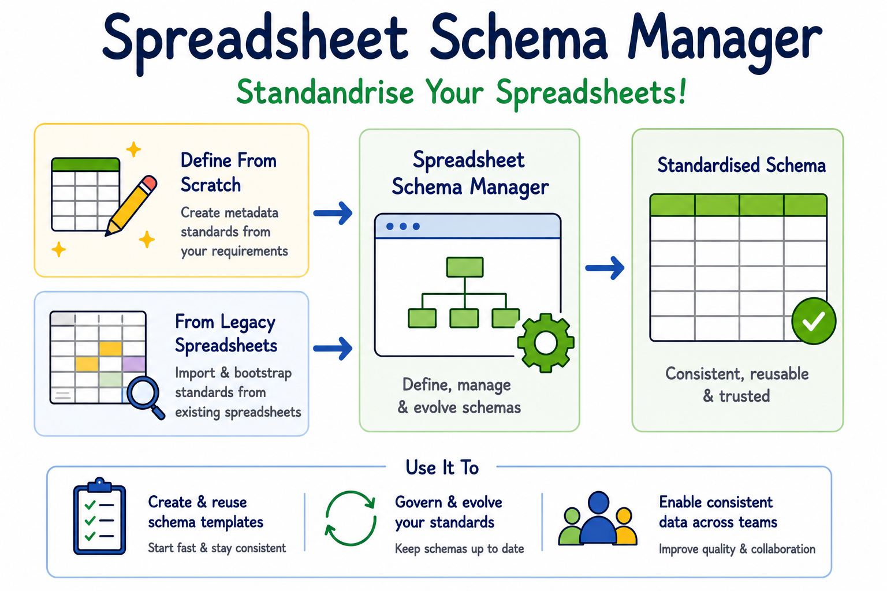

# Spreadsheet Schema Manager

[GitHub](https://github.com/Plant-Food-Research-Open/spreadsheet-schema-manager) |
[Releases](https://github.com/Plant-Food-Research-Open/spreadsheet-schema-manager/releases) |
[Issues](https://github.com/Plant-Food-Research-Open/spreadsheet-schema-manager/issues) |
[Release notes](about/release-notes.md)

Spreadsheet Schema Manager (SSM) is a web app for standardising spreadsheet metadata and
improving data consistency across projects and teams. Define your data columns once as
**Fields**, generate ready-to-fill Excel workbooks from them, and bring existing spreadsheets
into line with the same standard.



## What you can do

- **Centrally define Fields**: column definitions (Category, Measurement, Text,
  Number, Date) reused across projects, with import/export to and from Excel.
- **Generate Excel workbooks**: group Fields into a **Template**, then create a **Workbook**
  with pre-filled headers and data validation, ready for data collection.
- **Standardise existing spreadsheets**: upload legacy data as a **Dataset**, map its columns
  and values onto your Fields, and download a standardised copy. You can also use a legacy
  spreadsheet to bootstrap a new set of Fields.

:::{note}
SSM currently supports spreadsheets containing a single table with a fixed set of columns
and simple, single-row headers.
:::

## Where to start

- New to SSM? Read [Concepts](getting-started/concepts.md), then follow the
  [tutorials](tutorials/index.md), starting with the first.
- Running your own instance? See [Deploy and operate](deploy/index.md).
- Contributing? See [Develop](develop/index.md).

```{toctree}
:maxdepth: 2
:caption: Getting started
:hidden:

getting-started/concepts
getting-started/settings
```

```{toctree}
:maxdepth: 2
:caption: Learn
:hidden:

tutorials/index
how-to/index
reference/index
```

```{toctree}
:maxdepth: 2
:caption: Run and develop
:hidden:

deploy/index
develop/index
```

```{toctree}
:maxdepth: 1
:caption: About
:hidden:

about/release-notes
about/license
```
