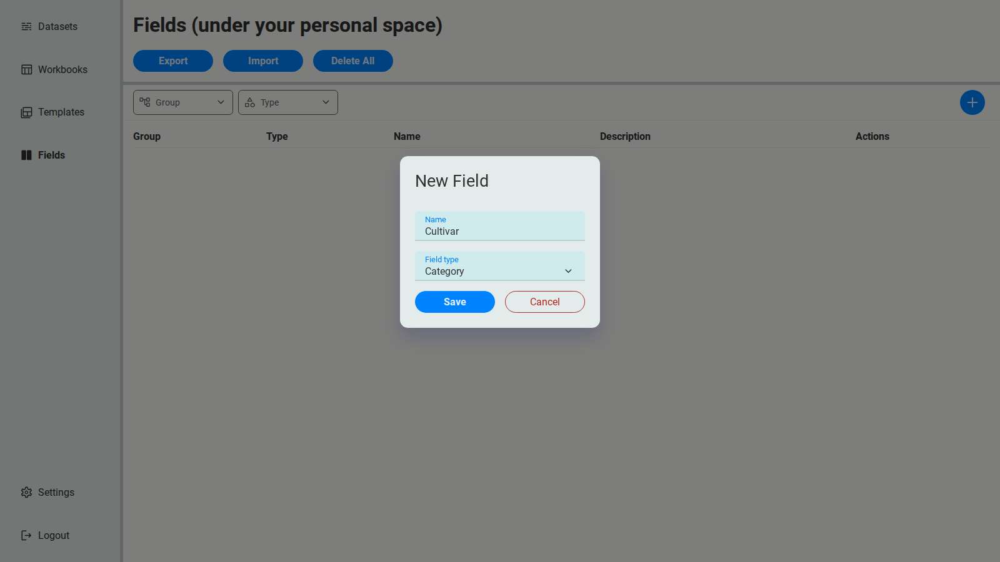
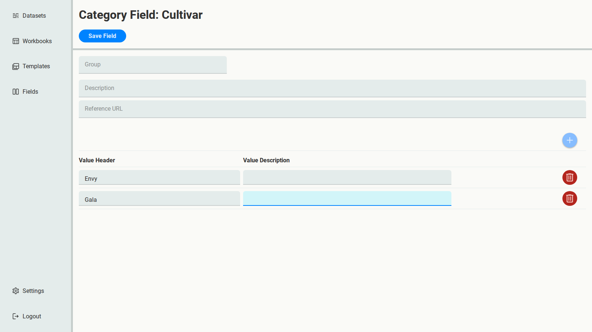
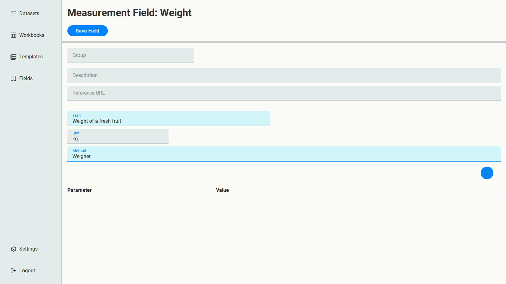
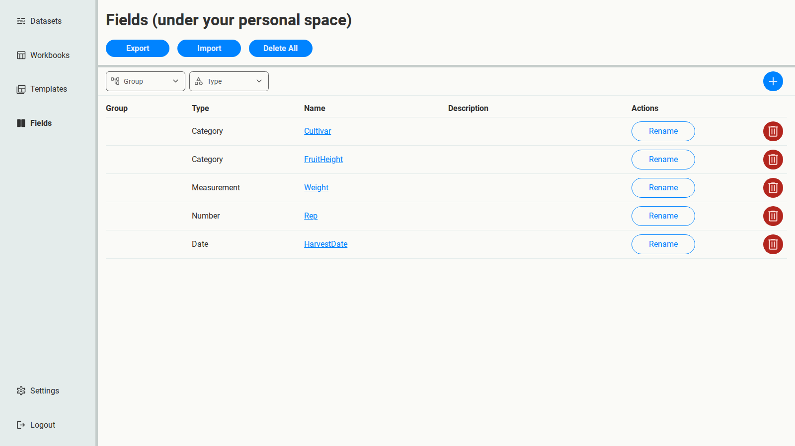
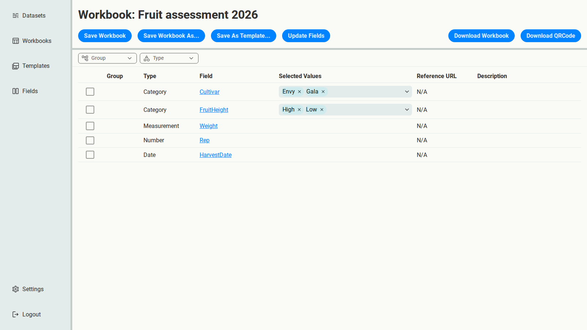
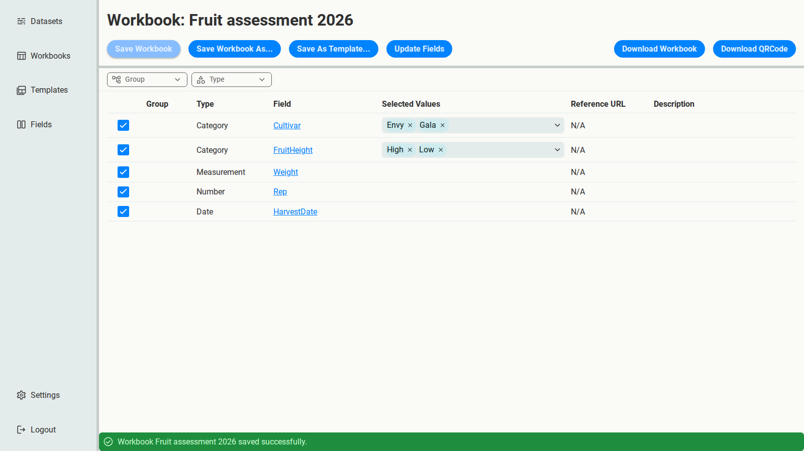
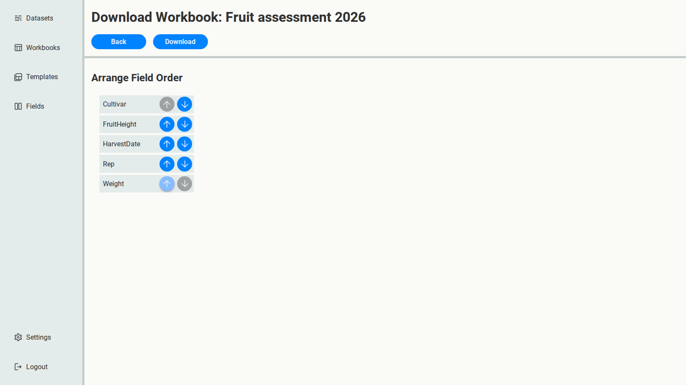

# Your first Workbook

You're about to run a fruit assessment trial, and you want everyone to record their
measurements the same way. In this tutorial you'll define the trial's columns as **Fields**,
then create a **Workbook**: an Excel file with those columns and dropdowns, ready to fill in.

## Create the Fields

You'll create five Fields, one per column:

| Field | Type | What it records |
| --- | --- | --- |
| Cultivar | Category | The apple cultivar: Envy or Gala |
| FruitHeight | Category | Where on the tree the fruit grew: High or Low |
| Weight | Measurement | Each fruit's weight |
| Rep | Number | The replicate number |
| HarvestDate | Date | When the fruit was picked |

### Cultivar, a Category Field

1. Open **Fields** and select the **+** button.
2. Enter the name `Cultivar`, choose the **Category** type, and select **Save**.

   

3. Select **Cultivar** in the list to open it.
4. A Category Field needs its allowed values. Select **+** to add a value, and enter `Envy`.
   Select **+** again and enter `Gala`.
5. Select **Save Field**.

Create **FruitHeight** the same way, with the values `High` and `Low`. A value can have a
description too; here, `Upper canopy` and `Lower canopy` make the meaning clear.

### Weight, a Measurement Field

Create a Field named `Weight` with the **Measurement** type, and open it. A Measurement needs
three things, which together say what was measured and how:

- **Trait**: `Weight of a fresh fruit`
- **Unit**: `kg`
- **Method**: `Weigher`

Fill them in and select **Save Field**.

:::{tip}
A weigher needs little explanation, but many measurements depend on how an instrument is set
up and used: fruit firmness with a penetrometer, for example, depends on the probe size and
the depth it's pushed in. For those, put a link to the measurement's SOP (standard operating
procedure) in **Reference URL**, so anyone reading the data can find out exactly how it was
measured.
:::

### Rep and HarvestDate

Create `Rep` with the **Number** type and `HarvestDate` with the **Date** type. They have no
further properties, so there's nothing to fill in after creating them.

Your Fields page now lists all five.

## Create the Workbook

1. Open **Workbooks**, select **+**, and name the Workbook `Fruit assessment 2026`.
2. Open it. Every Field you have is listed, unticked.

   

3. Tick all five Fields. For Category Fields, **Selected Values** shows which values the
   Workbook offers: all of them, for now.
4. Select **Save Workbook**.

## Download it

1. Select **Download Workbook**.
2. Use the arrows to put the Fields in the order people will fill them in: `Cultivar`,
   `FruitHeight`, `HarvestDate`, `Rep`, `Weight`.
3. Select **Download**.

Open the file in Excel. On the **RawData** sheet:

- the column headers are your Fields, in your order;
- Cultivar and FruitHeight cells have dropdowns of their values, so nobody can type `gala` or
  `H` by mistake;
- HarvestDate cells are formatted as dates.

The other sheets describe the data: **FieldDefinitions** holds every Field's definition,
including Weight's unit and method, and **Metadata** has rows for the project's details. See
[Anatomy of a Workbook](../reference/workbook-anatomy.md) for all of them.

Next: [Reuse a setup with Templates](templates.md).
