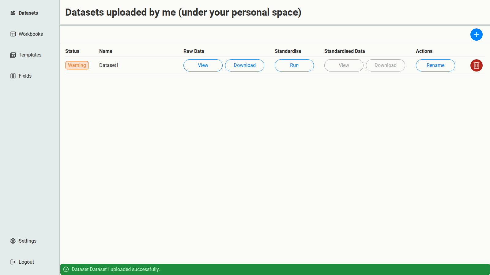
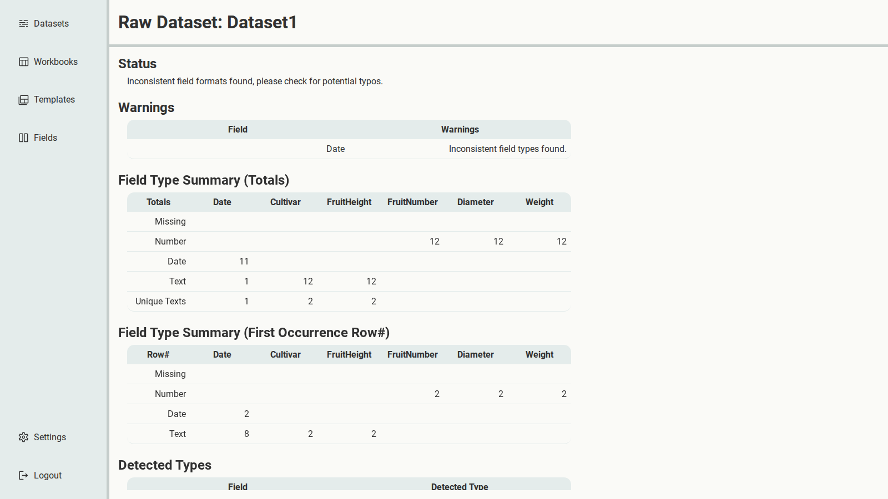

# 1. Upload and check a spreadsheet

Start with {download}`Dataset1.csv <../../_static/tutorial-data/Dataset1.csv>`: twelve fruit
measurements from a 2025 trial.

## Upload it

1. Open **Datasets** and select the **+** button.
2. Choose `Dataset1.csv` and select **Save**.

SSM checks the file as it uploads, and gives it a status: **Ready**, **Warning** or **Invalid**.
`Dataset1` comes back with a **Warning**.

## Find the problem

Under **Raw Data**, select **View**. This page shows what SSM detected in each column.

- **Warnings** says the `Date` column has inconsistent field types.
- **Field Type Summary (Totals)** shows why: 11 of its values look like dates, but 1 looks like
  text.
- **Field Type Summary (First Occurrence Row#)** shows where: the first text value in `Date` is
  on row 8.

Open the file and look at row 8. Its date is `206/2025`: a typo for `2/06/2025`.

## Fix it, then upload again

SSM doesn't edit your data: cleaning it is up to you, in the tool you normally use. That
keeps every change to the data itself under your control, and visible.

Here, the fixed copy is ready for you:
{download}`Dataset1_fixed.csv <../../_static/tutorial-data/Dataset1_fixed.csv>`.

1. Upload `Dataset1_fixed.csv`. Its status is **Ready**.
2. Delete `Dataset1`: select the red bin button at the end of its row, and confirm.

The data is clean, but its column names and codes are still its own. Next, you'll turn them
into Fields.
