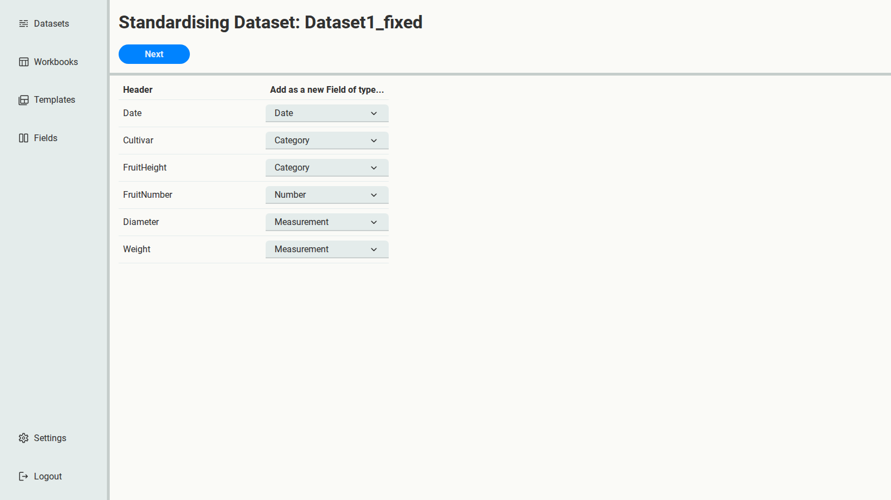
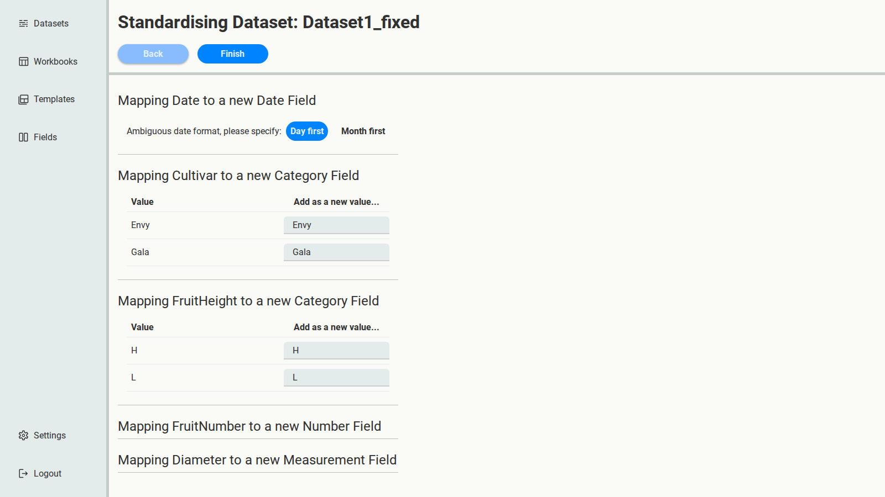
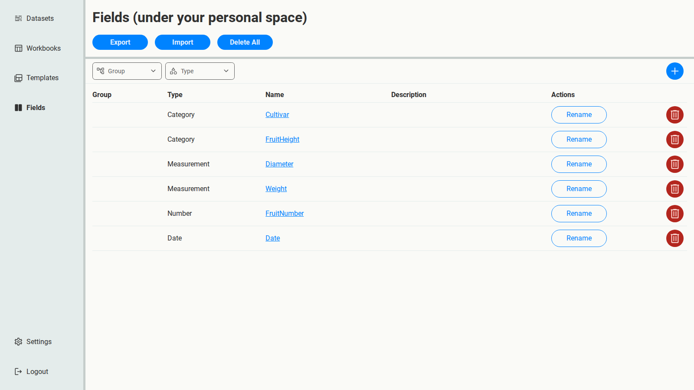

# 2. First pass: draft Fields from Dataset1

You have no Fields yet. In this first pass, you'll create them from `Dataset1_fixed`, as if you
didn't know what other data was coming: accept SSM's suggestions unless they're clearly wrong.

On the Datasets page, select **Run** under **Standardise** for `Dataset1_fixed`.

## Columns

The first page lists every column. Since there are no Fields to map to yet, each one becomes a
new Field, and SSM suggests a type based on its values.

Keep the suggestions except for `FruitNumber`. This one isn't a matter of taste: it's a
replicate number that identifies a fruit, not a measured quantity, so a Measurement's trait,
unit and method would mean nothing for it. Change its type from **Measurement** to **Number**.
Then select **Next**.

## Values and dates

The second page shows how each column's values will be mapped.

- **Date**: values like `1/06/2025` could be 1 June or 6 January, so SSM asks which order the
  file uses. These are New Zealand dates, so keep **Day first**.
- **Cultivar** and **FruitHeight**: each distinct value becomes a value of the new Category
  Field. Keep them as they are: `Envy` and `Gala`, `H` and `L`.

Select **Finish**. The Dataset's status changes to **Complete**.

## Look at the result

Open **Fields**. There are now six, one per column.

These are a draft. The standardised copy of `Dataset1_fixed` that SSM just made uses them, but
don't download it yet: the Fields will change once you've seen the second spreadsheet.
