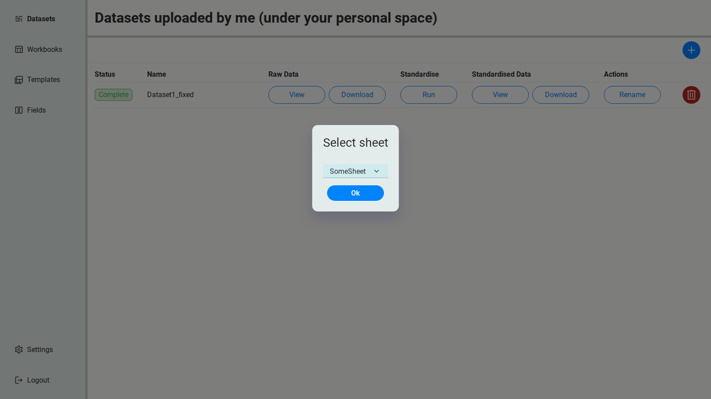
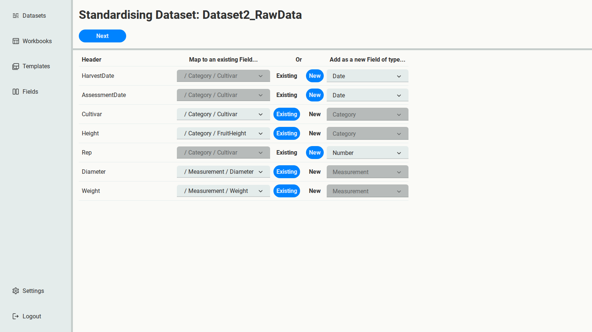
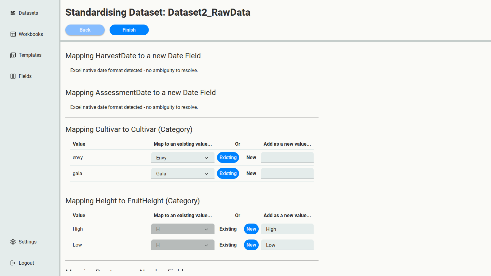

# 3. First pass: fit Dataset2 into the schema

{download}`Dataset2.xlsx <../../_static/tutorial-data/Dataset2.xlsx>` comes from the 2026 season,
recorded by someone else. It holds the same kind of data, but:

- its columns are named differently: `Height` instead of `FruitHeight`, `Rep` instead of
  `FruitNumber`;
- it has two dates: `HarvestDate` and `AssessmentDate`;
- cultivars are lower case (`gala`, `envy`), and heights are `Low` and `High` rather than
  `L` and `H`.

This time there are Fields to map to, so you'll make real decisions about the schema.

## Upload it

Upload `Dataset2.xlsx`. The file has two sheets, so SSM asks which one holds the data. Choose
**RawData**.

The Dataset is named `Dataset2_RawData`, after the file and sheet.

## Columns

Select **Run**. Now each column can be mapped to an **Existing** Field, or added as a **New**
one.

SSM matches columns to Fields by name, and its guesses need checking:

- `Cultivar`, `Diameter` and `Weight` correctly match the existing Fields.
- `Height` is matched to **Weight**, because the names look alike. That's simply wrong: change
  it to **FruitHeight**.
- `Rep` is suggested as a new Measurement. It means the same as Dataset1's `FruitNumber`, but
  adopt Dataset2's name, the same way as the dates below: keep it **New**, and change its type
  to **Number**.
- `HarvestDate` and `AssessmentDate` are suggested as new Date Fields. Before accepting that,
  read the next section.

:::{tip}
Always check every suggested match: a similar-looking name isn't the same Field.
:::

### Dataset2 makes Dataset1's Date ambiguous

Dataset1 had one date column, `Date`, and on its own that was clear enough. Dataset2 records
two dates, `HarvestDate` and `AssessmentDate`, so it's no longer obvious which of them
Dataset1's `Date` was.

This happens all the time: you can't design the perfect schema up front, because later data
can make an existing Field ambiguous. The fix is a question for whoever owns Dataset1, not
something SSM can work out from the data. For this tutorial, assume you asked, and the answer
came back: Dataset1's `Date` is the **harvest** date.

That leaves a naming decision: keep the name `Date`, or adopt Dataset2's names? `HarvestDate`
and `AssessmentDate` say exactly what each date is, so adopt them: keep both as **New** Date
Fields. You'll remove the old `Date` Field when you curate the schema in the next chapter, and
map Dataset1's `Date` column to `HarvestDate` in the second pass.

Select **Next**.

## Values

- The two date columns hold real Excel dates, so there's no day/month order to decide.
- `envy` and `gala` already match the existing `Envy` and `Gala`, despite the different case.
- `Low` and `High` don't match `L` or `H`, so they're suggested as new FruitHeight values.

This is the same kind of decision as the dates. `Low` and `High` are clearer than `L` and `H`,
and you want them in your final schema, so **adopt** them: keep them as **New** values. For
now, FruitHeight has both pairs; you'll remove `H` and `L` when you curate the schema, and map
Dataset1's `H` and `L` onto `High` and `Low` in the second pass.

:::{note}
In the first pass, adding something as **New** is how you adopt it into the schema, even when
it overlaps with something that already exists. The overlaps are cleaned up in one place,
during curation.
:::

Select **Finish**.

## Where you are

Your Fields now overlap:

| Overlap | Decision |
| --- | --- |
| `Date` and `HarvestDate` | Keep `HarvestDate`: Dataset1's owner confirmed its `Date` is the harvest date |
| FruitHeight has `H`, `L`, `High` and `Low` | Keep `High` and `Low`, the clearer names |
| `FruitNumber` and `Rep` | Keep `Rep`, adopted from Dataset2 |

Next, you'll tidy that up.
