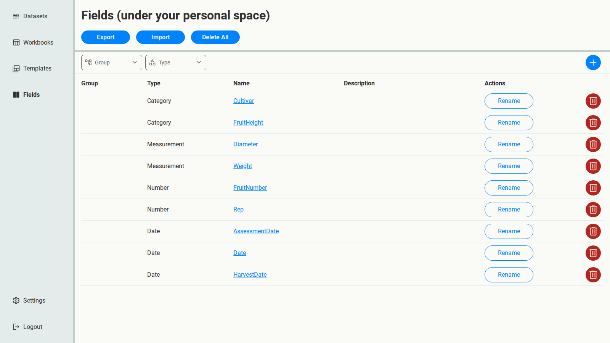
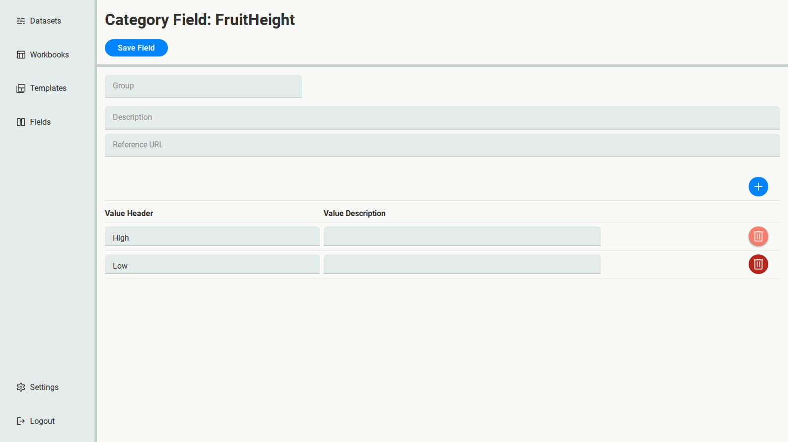
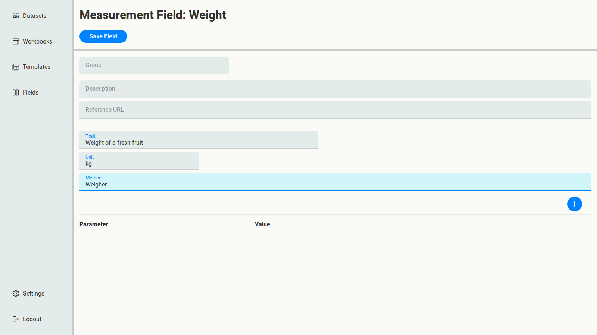
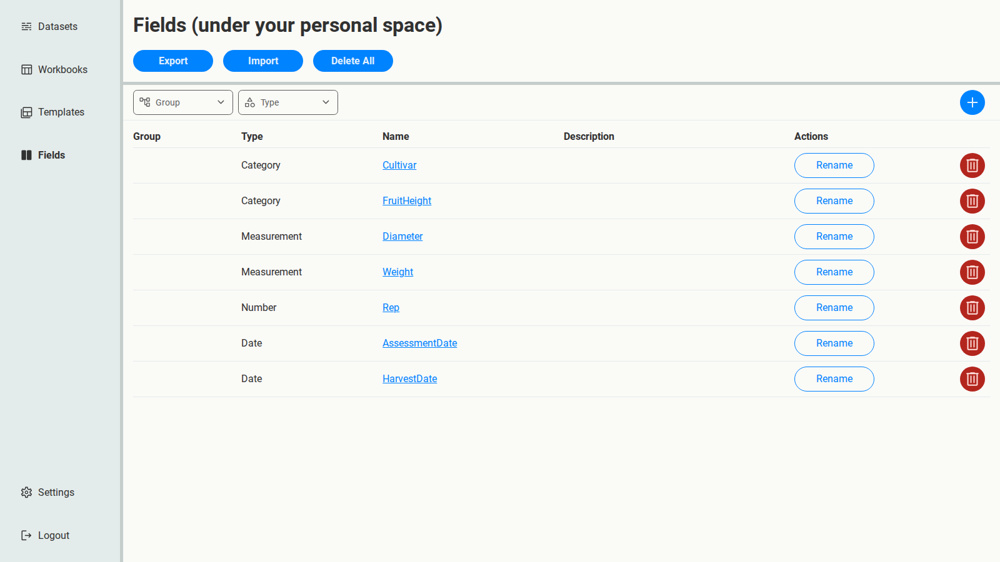

# 4. Curate and finalise the Fields

The first pass gave you a draft schema with overlaps, and you've already decided how to
resolve them (see the end of [chapter 3](03-fit-second-dataset.md)). Now apply those
decisions. Everything in this chapter happens on the **Fields** page.

## Remove the old values

1. Open **FruitHeight**.
2. Delete the `H` and `L` rows, leaving `High` and `Low`.
3. Select **Save Field**.

## Remove the superseded Fields

Back on the Fields page, delete **FruitNumber** and **Date**. `Rep` and `HarvestDate` replace
them.

## Describe the Measurements

A Measurement should say what was measured, in what unit and how. That makes the data
understandable to someone who wasn't there.

1. Open **Diameter**. Set **Trait** to `Diameter of a fresh fruit`, **Unit** to `cm` and
   **Method** to `Ruler`. Select **Save Field**.
2. Open **Weight**. Set **Trait** to `Weight of a fresh fruit`, **Unit** to `kg` and
   **Method** to `Weigher`. Select **Save Field**.

## The final schema

Seven Fields: `Cultivar`, `FruitHeight`, `Diameter`, `Weight`, `Rep`, `AssessmentDate` and
`HarvestDate`.

To check your work, select **Export** and compare the file with
{download}`Fields.xlsx <../../_static/tutorial-data/Fields.xlsx>`.
