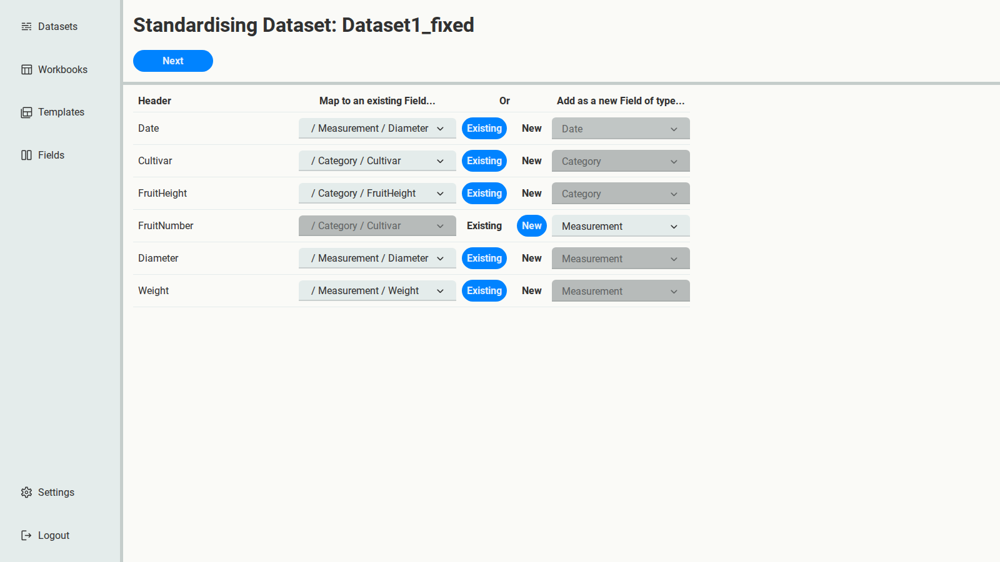
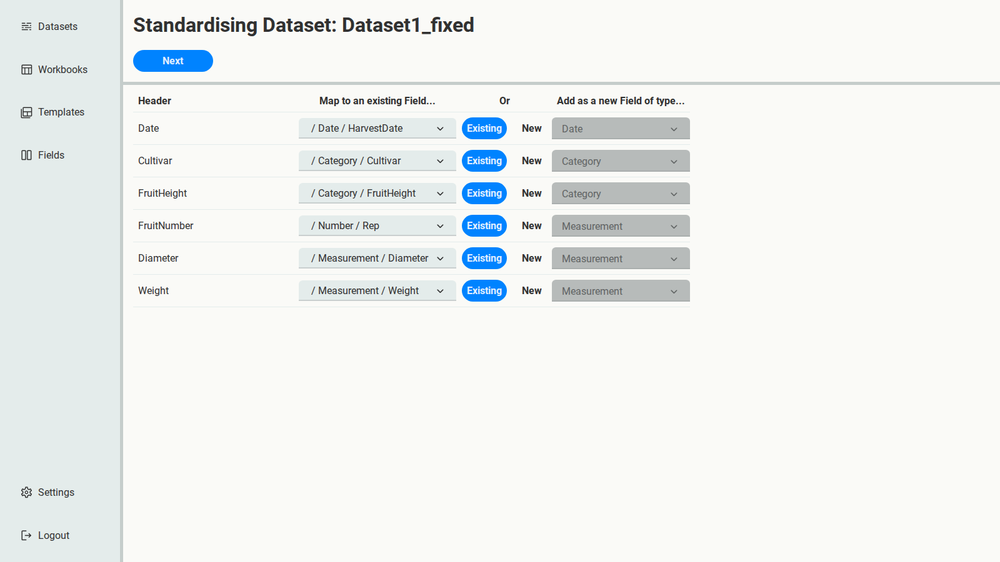
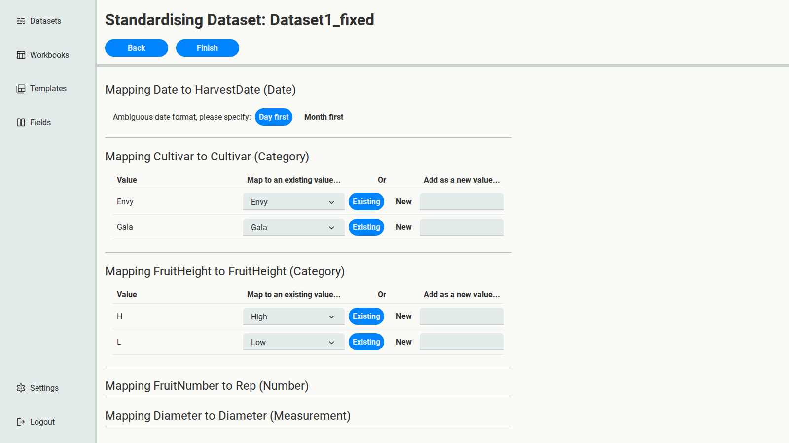
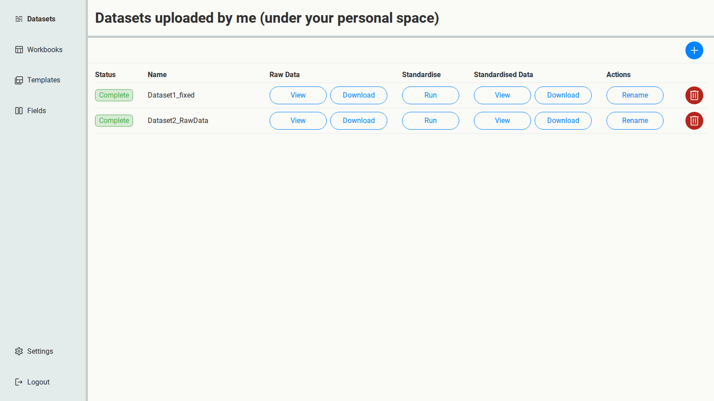

# 5. Second pass: produce standardised files

With the Fields final, standardise both spreadsheets again. This time, the output is what you
keep.

:::{tip}
Skipped ahead? Upload `Dataset1_fixed.csv` and `Dataset2.xlsx` (RawData sheet), then on the
Fields page select **Import** and choose
{download}`Fields.xlsx <../../_static/tutorial-data/Fields.xlsx>`. You now have the final Fields,
ready for this chapter.
:::

:::{tip}
With final Fields, every choice in the second pass should be **Existing**, for both columns
and values. If you find yourself choosing **New** for anything, your Fields aren't final yet:
go back to [curation](04-curate-fields.md) and add it to the schema there, deliberately.
:::

## Dataset1_fixed

Select **Run** for `Dataset1_fixed`. SSM suggests Fields for each column again, now based on
the final schema.

Two columns need correcting:

- `Date` is matched to **Diameter**. Change it to **HarvestDate**.
- `FruitNumber`'s Field no longer exists, so it's suggested as new. Switch it to **Existing**
  and choose **Rep**.

Select **Next**. Keep **Day first** for the date, then fix FruitHeight's values: `H` and `L`
are no longer FruitHeight values, so they're suggested as new. Switch each one to **Existing**,
and choose `High` for `H` and `Low` for `L`.

Select **Finish**.

## Dataset2_RawData

Select **Run** for `Dataset2_RawData`. Only `Height` needs correcting, to **FruitHeight**, just
like the first time. On the next page every value already matches, so select **Finish**.

## Download and inspect

Both Datasets are now **Complete**.

Under **Standardised Data**, select **Download** for each. Open the files and look at:

- **RawData**: the data, with the final column names, values and ISO dates. `Dataset1_fixed`'s
  `H` is now `High`, its `Date` is `HarvestDate`, and its dates read `2025-06-01`.
- **FieldDefinitions**: the definition of every Field used.
- **StandardisationLog**: every decision you made, column by column and value by value. Its
  **Date order** column records `Day first (selected)` for `Dataset1_fixed`, since you chose
  it, and `Unambiguous` for `Dataset2_RawData`'s Excel dates.

Compare with the expected results:
{download}`Dataset1_fixed.std.xlsx <../../_static/tutorial-data/Dataset1_fixed.std.xlsx>` and
{download}`Dataset2_RawData.std.xlsx <../../_static/tutorial-data/Dataset2_RawData.std.xlsx>`.
See [Anatomy of a Workbook](../../reference/workbook-anatomy.md) for every sheet.

The two spreadsheets now share one schema, so they can be combined directly.
