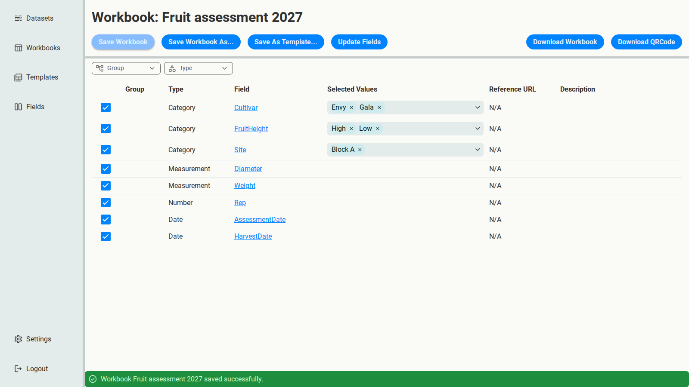

# 6. Collect next season's data

Standardising old data is a repair job. With your Fields final, avoid the repair next time by
collecting new data to the standard from the start. This chapter applies what
[Reuse a setup with Templates](../templates.md) explains in detail.

Next season's trial assesses both cultivars again, all at one site, Block A. The earlier
spreadsheets never recorded a site at all: it was the same for the whole trial, so it lived
only in the reports.

1. **Add a Site Field.** This is a deliberate addition to the schema, so make it on the Fields
   page, not during standardisation: a Category Field `Site` with the values `Block A` and
   `Block B`.
2. **Create a Template**, `Fruit assessment`, with all eight Fields ticked.
3. **Create a Workbook** from it, `Fruit assessment 2027`, and narrow Site to `Block A`.

Site is now a [constant Category Field](../../getting-started/concepts.md#constant-category-fields):
the downloaded Workbook records `Block A` on its ConstantCategoryFields sheet. That's exactly
the kind of fact the old spreadsheets lost. With it kept, this season's data can be combined
with the earlier, standardised data, and with data from other sites.

Download the Workbook with the Fields in the order people will fill them in: `Site`, then
`Cultivar`, `FruitHeight`, `HarvestDate`, `AssessmentDate`, `Rep`, `Diameter` and `Weight`.
For sample-bag labels, **Download QRCode** lists the four Cultivar × FruitHeight combinations.

That's the whole cycle: legacy data in, one shared schema out, and new data collected to that
schema from the start.
