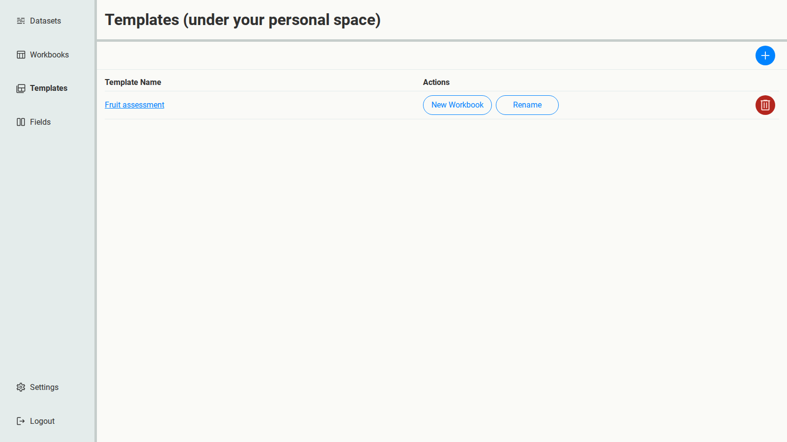
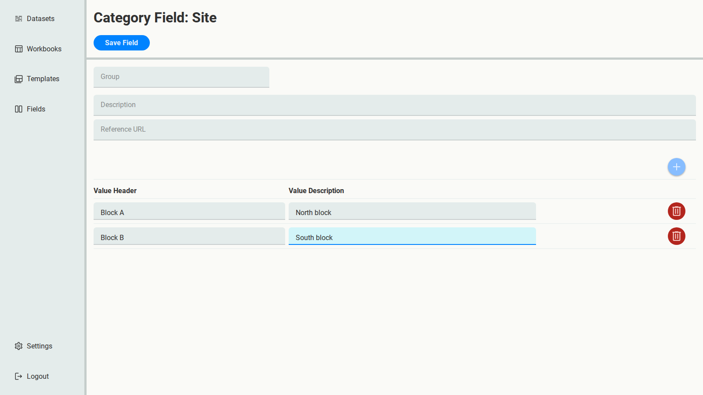
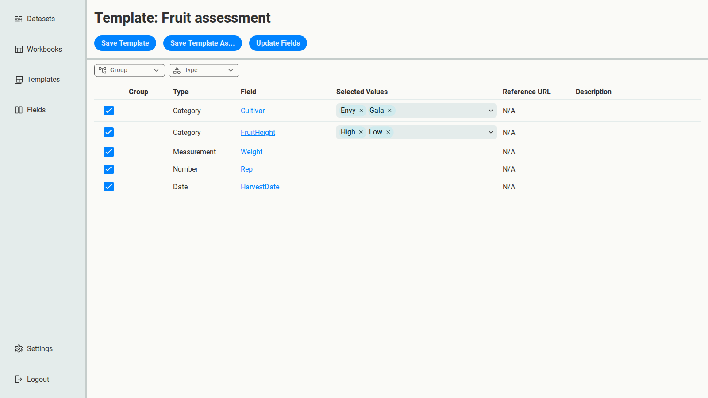
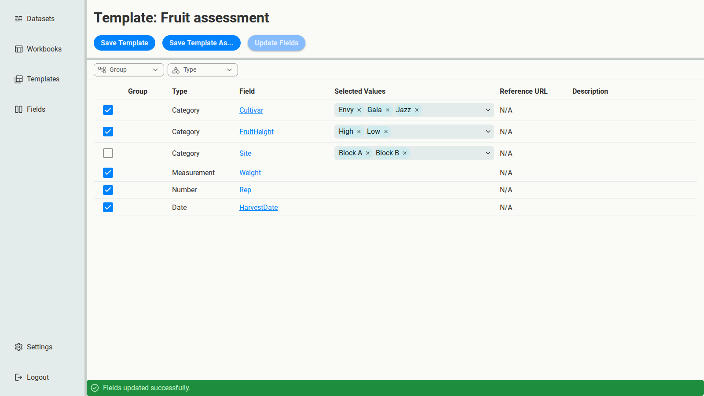
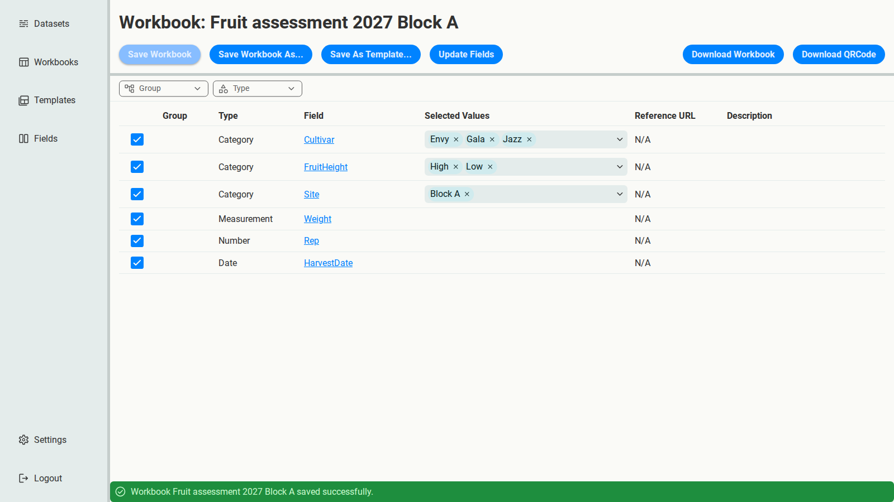

# Reuse a setup with Templates

The 2026 trial went well, and you'll run it again next season. In this tutorial you'll save
the Workbook's setup as a **Template**, update it for next season's changes, and create the
next Workbook from it.

This continues from [Your first Workbook](first-workbook.md): you need its Fields and its
`Fruit assessment 2026` Workbook.

## Save the Workbook as a Template

1. Open the `Fruit assessment 2026` Workbook.
2. Select **Save As Template...**, name it `Fruit assessment`, and save.

A Template is a saved selection of Fields and values to start new Workbooks from. Templates
are optional: they're worth it when you create similar Workbooks repeatedly, like one per
season.

## Change the Fields for next season

Two things change for 2027:

1. **A new cultivar.** Open the **Cultivar** Field, add the value `Jazz`, and select
   **Save Field**.
2. **A second site.** The trial now runs in two orchard blocks, and each block's data needs to
   say which block it came from. Create a new Category Field, `Site`, with the values
   `Block A` (North block) and `Block B` (South block).

## Update the Template

Open the `Fruit assessment` Template. Nothing has changed: no Jazz, no Site.

That's deliberate. A Template, like a Workbook, keeps its own copy of its Fields, so editing
Fields never silently changes it. The 2026 Workbook still produces exactly the same file as
it did in 2026, which keeps past setups reproducible.

To bring the Template up to date on purpose, select **Update Fields**:

- Cultivar now offers `Jazz` as well. New values are selected automatically.
- **Site** is listed, but unticked: new Fields are never added to a Template without your say.

Tick **Site**, then select **Save Template**. The update only sticks once you save.

## Create the 2027 Workbook

1. On the Templates page, select **New Workbook** for `Fruit assessment`, and name it
   `Fruit assessment 2027 Block A`.
2. Open it from **Workbooks**. It starts with the Template's selections.
3. This Workbook is for Block A only. Under **Selected Values**, remove `Block B` from Site.
4. Select **Save Workbook**.

## Constant values are kept

Site now has a single value in this Workbook: every row of its data comes from Block A. That
makes Site a [constant Category Field](../getting-started/concepts.md#constant-category-fields).

In a spreadsheet made by hand, a column that's the same on every row usually gets dropped, and
the fact that it was all Block A ends up only in a report. The Workbook keeps it instead: when
you download it, Site isn't a column on the RawData sheet, but it's recorded, with its value,
on the **ConstantCategoryFields** sheet. So this season's data can later be combined with
Block B's without losing track of which block is which.

## Print labels

Select **Download QRCode**. It downloads an Excel file listing every combination of the
Workbook's Category Fields that have more than one value. Here that's Cultivar (3 values) and
FruitHeight (2 values), so 6 rows:

| Cultivar | FruitHeight |
| --- | --- |
| Envy | High |
| Envy | Low |
| Gala | High |
| Gala | Low |
| Jazz | High |
| Jazz | Low |

Each row is one label to print, for example as a QR code on each sample bag. Site isn't listed,
since it's the same on every label.

For Block B, create another Workbook from the same Template and narrow Site to `Block B`
instead.

Next, when you have existing spreadsheets to bring into line:
[From legacy spreadsheets to a shared schema](legacy/index.md).
